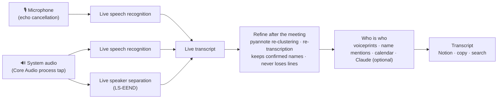

<div align="center">


# Verbatim

**Every word of your meetings, with who said it and when. On your Mac, nowhere else.**

A macOS menu bar app that transcribes meetings live, separates speakers, learns their names,
and saves the full transcript to Notion in one click. No bot joins your call. No summary
replaces what was said.

[](https://github.com/oliverxuzy-ai/verbatim/releases/latest)
[](#requirements)
[](https://www.swift.org)
[](LICENSE)

English · [简体中文](README.zh-CN.md)


</div>

## Why Verbatim

Most meeting tools record through a bot that joins the call, upload the audio, and hand you a summary. Verbatim takes the other path:

- **Nothing joins your call.** It listens to your microphone and to the audio your Mac is already playing (Zoom, Meet, Teams, Slack, anything), so it works with every app and nobody sees a recorder in the participant list.
- **Private by default.** The default engine is Apple's on-device speech recognition, and speaker separation runs locally too. Audio never leaves your Mac unless you choose a cloud engine.
- **The transcript, not a summary.** You get every sentence, the speaker and a timestamp. Summarize it however you like afterwards.
- **It learns who is who.** Confirm a voice once and Verbatim recognizes that person in every later meeting.

## Features

### Recording
- **Start from anywhere**: the Today page (today's meetings, one click to record), the menu bar, the ⌘K command bar, the Dock icon, or **⌥⌘R** from any app. A notification at meeting start lets you begin with one tap.
- **A tiny floating capsule** with a live voice meter, pause and stop. It never steals focus and is **hidden from screen sharing**.
- **Two separate channels**: your microphone is you, the system audio is everyone else. Echo cancellation turns on automatically when you use speakers, and anything the mic picks up from the call is removed from your side.
- **Stops by itself** when the meeting is over (call audio silent, nobody talking, or the calendar slot has ended), with a 60-second countdown you can cancel. On by default, can be turned off.
- **Online or in-person, detected automatically.** If almost nothing comes through the system audio, Verbatim treats it as an in-room meeting and separates the voices on the microphone.

### Transcript
- **Live transcript** with speakers and timestamps, sentences fading in as they are recognized and a "Jump to live" button when you scroll back.
- **Live speaker separation** for the remote side with an on-device model (FluidAudio LS-EEND).
- **Refine after the meeting** (on by default): the whole recording is re-clustered with pyannote (95–97% word-level speaker accuracy on real AMI meetings in our benchmark) and, with the Apple engine, re-transcribed from the lossless audio. Names you already confirmed are kept, sentences the refine missed are restored from the live version, and if the result is clearly worse the original stays.
- **Recognition hints**: the meeting title, attendee names and your own vocabulary list are fed to the recognizer.
- **Edit everything**: rename the meeting inline, fix a line's text or speaker, merge two speakers that are really one person.

### Knowing who spoke
Verbatim combines several signals and only suggests a name when the evidence is strong. You confirm with one click.

1. **Voiceprints**: anyone you confirmed once is recognized automatically next time (thresholds calibrated on real AMI recordings).
2. **How people talk**: "I'm Grant" names the speaker; "Grant, can you…" points at whoever answers next; "Thanks, Grant" at whoever spoke before. It tolerates near misses like "Grand" and only accepts invitees.
3. **Calendar rules**: 1:1 meetings, elimination, and names in titles like "Oliver / Hsiao".
4. **Optional: Claude reads the conversation** and suggests names, limited to invitees or names actually said in the meeting, marked as unconfirmed.

### Calendar and export
- **Google Calendar** sign-in, direct (no macOS Calendar needed): meetings, attendees and Meet / Zoom links.
- **One-click export to Notion**: a new page with title, date and time range, duration, attendees, meeting link and the full transcript (`[00:12:34] Name: text`) in a toggle, plus empty headings for your own notes.
- **Copy** the whole transcript with timestamps and speakers.
- **⌘K command bar** searches every transcript by title, speaker and content.

## Screenshots

<table>
  <tr>
    <td width="50%"><br><sub><b>Today</b>: your meetings, one click to record.</sub></td>
    <td width="50%"><br><sub><b>Transcript</b>: speakers, timestamps, confirm names.</sub></td>
  </tr>
  <tr>
    <td width="50%"><br><sub><b>Menu bar</b>: the next meetings, always one click away.</sub></td>
    <td width="50%" align="center"><br><sub><b>Capsule</b>: voice meter, pause, stop. Invisible when you share your screen.</sub></td>
  </tr>
</table>

## Install

1. Download the latest **`Verbatim-<version>.dmg`** from [Releases](https://github.com/oliverxuzy-ai/verbatim/releases/latest).
2. Open it and drag **Verbatim** into **Applications**.
3. The app is not notarized by Apple, so macOS blocks the first launch. Click **Done**, then open **System Settings → Privacy & Security**, scroll down and click **Open Anyway** next to Verbatim. You only do this once.
   Or run this in Terminal:
   ```bash
   xattr -dr com.apple.quarantine /Applications/Verbatim.app
   ```
4. Follow the short onboarding: grant the permissions below and, optionally, connect Google Calendar and Notion.

Updating: download the new DMG and drag it over the old copy. Your recordings and settings stay.

## Requirements

- **macOS 26** or later, Apple Silicon or Intel (the DMG is a universal build).
- **Permissions** (asked during onboarding):

| Permission | Why |
|---|---|
| Microphone | To transcribe what you (or the people in the room) say. |
| Screen & System Audio Recording | To capture the call audio other apps play. Verbatim uses a Core Audio process tap and never records your screen. |
| Speech Recognition | For Apple's on-device transcription. |

- On first use the speech model for your language and the speaker models (about a few hundred MB) are downloaded once.

> **Tip:** if the System Audio switch is on but the other side is still missing (a yellow dot appears next to the voice meter), turn Verbatim's switch off and on again in Privacy & Security.

## Transcription engines

| Engine | Best for | Notes |
|---|---|---|
| **Apple on-device** (default) | Single-language meetings | Free, offline, private. English, Mandarin, Taiwanese Mandarin, Japanese, Korean, Spanish, French, German. One language per meeting. |
| **Soniox** (cloud) | Highest accuracy, Chinese and English mixed in one meeting | Needs an API key from [console.soniox.com](https://console.soniox.com). About $0.12 per audio hour per channel. |

## Setup (optional integrations)

<details>
<summary><b>Google Calendar</b> (about 10 minutes, once)</summary>

Verbatim talks to Google Calendar with your own OAuth client, so no third party ever sees your calendar. It reads only your primary calendar's titles, times, attendees and video links. The same steps, with buttons, are in **Settings → Calendar**.

1. Create a project in the [Google Cloud Console](https://console.cloud.google.com/projectcreate) (any name, for example Verbatim).
2. Enable the [Google Calendar API](https://console.cloud.google.com/apis/library/calendar-json.googleapis.com) for it.
3. **Google Auth Platform → Branding**: app name Verbatim, your email. Under **Audience** choose **External** and click **Publish app** (otherwise Google signs you out every 7 days).
4. **Clients → Create client**, type **Desktop app**, then **Download JSON**.
5. In Verbatim, **Settings → Calendar → Import JSON…**, pick the file, then **Sign in with Google**. When Google says the app is unverified, choose **Advanced → Go to Verbatim** (it is your own client) and keep the calendar permission checked.

If your Google Workspace blocks unverified apps, ask IT to allow it, or create the project with your work account and choose **Internal** in step 3.
</details>

<details>
<summary><b>Notion</b></summary>

1. Create a token at [notion.so/developers](https://www.notion.so/developers) (a personal access token, or an internal integration that you add to the database under **••• → Connections**).
2. Paste it into **Settings → Notion** and click **Test**.
3. Paste the link of the database you want transcripts in.

Any database works: Verbatim fills the title column and the transcript, and fills these columns when they exist (matched by name): `会议日期` (date), `时长（分钟）` (number), `外部参会人`, `参会人（工作区成员）`, `录音 / 会议链接`, `来源`, `整理状态`. Missing columns are skipped.
</details>

<details>
<summary><b>Claude speaker naming</b></summary>

Paste an Anthropic API key in **Settings → Transcription → Speaker names** to let Claude suggest names from the conversation for voices that the other signals could not name. Only the transcript text is sent, and suggestions always need your confirmation.
</details>

## Privacy

| Data | Where it goes |
|---|---|
| Audio and transcripts | Stay on your Mac in `~/Library/Application Support/Verbatim/Recordings/<id>/` (`recording.json`, plus 16 kHz lossless `mic.m4a` and `system.m4a`). |
| API keys and tokens | A user-only file, `~/Library/Application Support/Verbatim/secrets.json` (mode 0600). |
| Calendar | Read directly from Google with your own OAuth client. |
| Network | Only when you use it: Soniox (if chosen as engine), Notion (on export), Anthropic (if you add a key), and one-time model downloads. |

## How it works



Each recording keeps the microphone and the system audio as separate lossless tracks from start to finish, so the refine pass can work on clean audio and "me" versus "them" never has to be guessed.

## Build from source

You need macOS 26, Xcode 26 and [XcodeGen](https://github.com/yonaskolb/XcodeGen) (`brew install xcodegen`). The Xcode project is generated from `project.yml`.

```bash
git clone https://github.com/oliverxuzy-ai/verbatim.git
cd verbatim
xcodegen generate
xcodebuild -project Verbatim.xcodeproj -scheme Verbatim -configuration Release -derivedDataPath build/DerivedData build
open build/DerivedData/Build/Products/Release/Verbatim.app
```

Run the tests (the first run downloads the speech and speaker models):

```bash
xcodebuild -project Verbatim.xcodeproj -scheme Verbatim -derivedDataPath ~/Library/Developer/VerbatimDerivedData test
```

Build the DMG: `scripts/package.sh` writes `build/Verbatim-<version>.dmg`.

Builds are ad-hoc signed with a designated requirement on the bundle ID, so microphone and system audio permissions survive rebuilds. To sign with your own certificate, pass `VERBATIM_SIGN_IDENTITY="Your certificate"`.

More for contributors (project layout, self-check modes, benchmarks, releases) is in [CONTRIBUTING.md](CONTRIBUTING.md).

## Roadmap ideas

- Notarized builds from an Apple Developer ID
- Export to Markdown and other note apps
- More calendar providers

Have an idea? [Open an issue](https://github.com/oliverxuzy-ai/verbatim/issues/new/choose).

## Contributing

Bug reports, ideas and pull requests are welcome. Start with [CONTRIBUTING.md](CONTRIBUTING.md). Every pull request is built and tested on a GitHub-hosted Mac and comes with a DMG you can try.

## Acknowledgements

- [FluidAudio](https://github.com/FluidInference/FluidAudio) for on-device speaker diarization (LS-EEND, pyannote, WeSpeaker on Core ML).
- [AMI Meeting Corpus](https://groups.inf.ed.ac.uk/ami/corpus/) (CC BY 4.0) and [pyannote/AMI-diarization-setup](https://github.com/pyannote/AMI-diarization-setup) for benchmark data.
- Ideas from [meetily](https://github.com/Zackriya-Solutions/meeting-minutes) and [anarlog](https://github.com/fastrepl/anarlog): separate channels throughout, re-transcribe after the meeting without ever making it worse, use attendees as hints, hide the overlay from screen sharing.

## License

[MIT](LICENSE) © Oliver Xu
