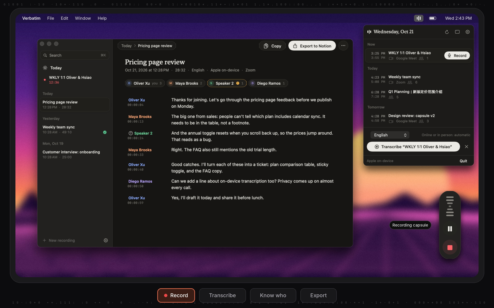
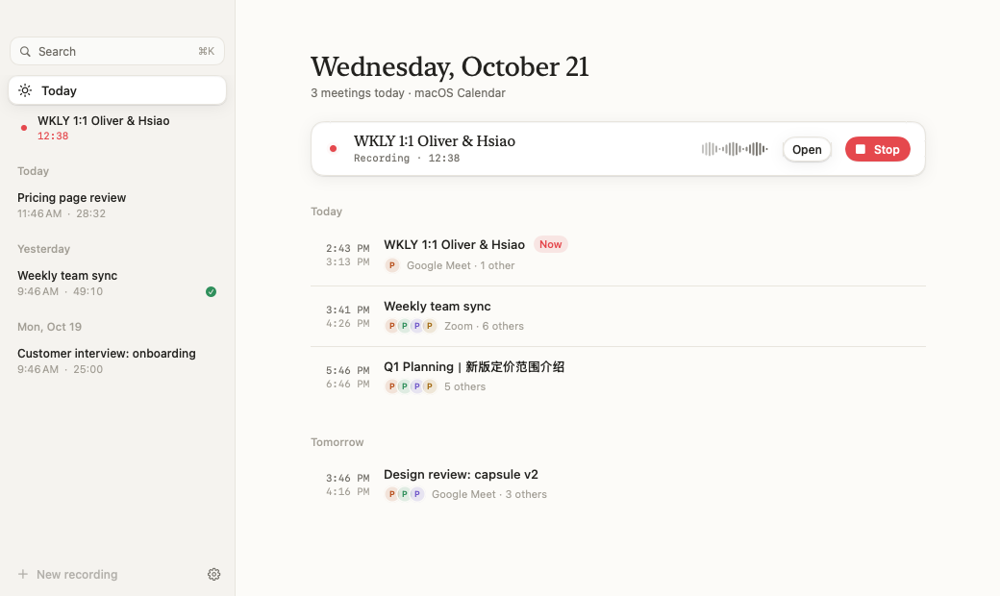
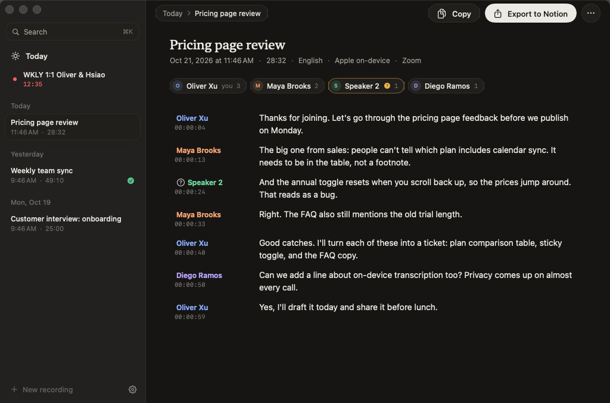
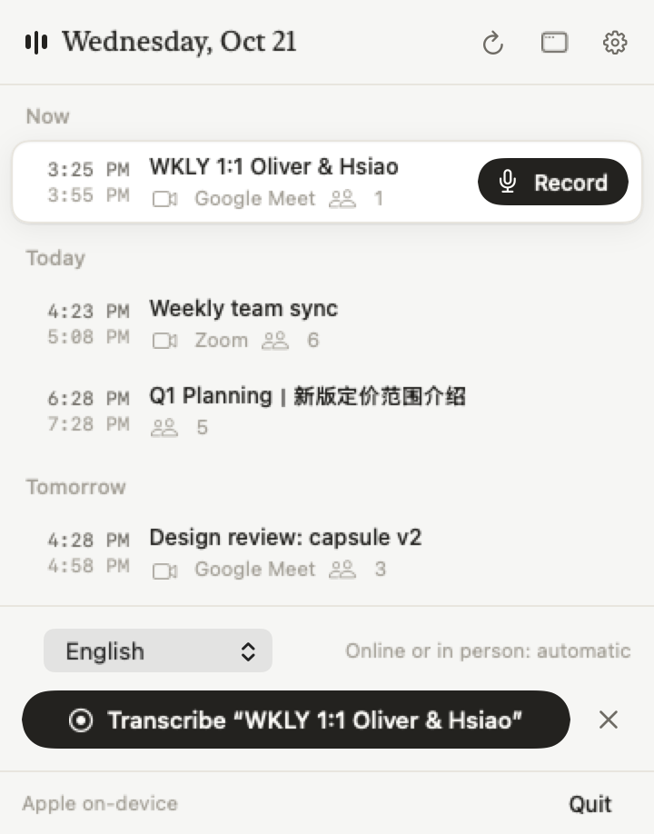
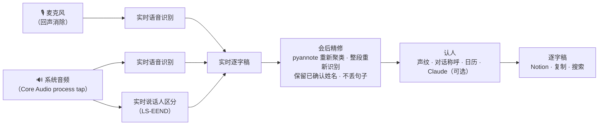

<div align="center">



# Verbatim

**会议里的每一句话、谁说的、什么时候说的。全在你自己的 Mac 上。**

macOS 菜单栏会议转写工具：实时转写、区分说话人、记住每个人的声音，一键把完整逐字稿存进 Notion。
不需要机器人进会，也不用总结代替原话。

[](https://github.com/oliverxuzy-ai/verbatim/releases/latest)
[](#系统要求)
[](https://www.swift.org)
[](LICENSE)

[English](README.md) · 简体中文



</div>

## 为什么做 Verbatim

大多数会议工具让一个机器人进会录音，把音频上传，再给你一份总结。Verbatim 走另一条路：

- **不进会**：直接听麦克风和 Mac 正在播放的声音（Zoom、Meet、Teams、Slack 都行），参会人列表里不会多出一个录音机器人。
- **默认隐私**：默认用 Apple 的设备端语音识别，说话人区分也在本地完成。除非你主动选云端引擎，音频不会离开你的 Mac。
- **要原话，不要总结**：每一句话、说话人、时间戳都在。总结你可以之后自己做。
- **认得人**：确认一次某个声音是谁，以后的会议自动认出来。

## 功能

### 录音
- **随处开始**：Today 首页（今天的会议按时间排好，一键 Record）、菜单栏、⌘K 命令栏、Dock 图标，或在任意 App 里按 **⌥⌘R**。会议开始时弹通知，点一下就开录。
- **胶囊悬浮框**：只有随声音跳动的声纹、暂停 / 继续、结束。不抢焦点，**屏幕共享时对别人不可见**。
- **两路分轨**：麦克风是你，系统音频是对方。外放时自动开启回声消除，麦克风里漏进的对方声音会被去掉。
- **会议结束自动停止**（默认开启，可关）：对方声音安静、没人说话或日历时间已过，就出现 60 秒倒计时，点一下或有人说话就继续录。
- **自动判断线上 / 线下**：系统音频里几乎没有声音时按线下会处理，对麦克风里的多个人做区分。

### 转写
- **实时转写**：带说话人和时间戳，逐句淡入，往上翻时出现「Jump to live」。
- **对方多人实时区分**：本地模型（FluidAudio LS-EEND）。
- **会后精修**（默认开启）：pyannote 对整场会议重新聚类说话人（AMI 真实会议实测逐词归属 95%~97%），Apple 引擎还会用无损录音整段重新识别。已确认的名字保留，精修漏掉的句子从实时稿补回，结果明显变差时保留原稿。
- **识别提示**：会议标题、参会人姓名、自定义词表自动作为识别提示。
- **都能改**：点标题直接改名，改单句文字或说话人，把被拆开的同一个人合并。

### 认人
多种线索结合，证据足够时才给出建议，你点一下确认：

1. **声纹库**：确认过一次的人以后自动认出（阈值用 AMI 真人录音标定）。
2. **对话里的称呼**：「I'm Grant」直接认出说话人；「Grant, can you…」指向下一个开口的人；「Thanks, Grant」指向上一个。容忍把 Grant 听成 Grand，只认参会人。
3. **日历规则**：1:1、排除法、标题里的名字（如「Oliver / Hsiao」）。
4. **可选：Claude 读对话推断姓名**：只接受参会人或对话里出现过的名字，标为待确认。

### 日历与导出
- **Google 日历**：直接登录，不经过 macOS 日历。读取会议、参会人和 Meet / Zoom 链接。
- **一键导出 Notion**：新建一页，填好标题、起止时间、时长、参会人、会议链接，逐字稿（`[00:12:34] 姓名: 内容`）放在折叠块里，另留空标题给你写笔记。
- **复制**整份逐字稿（带时间戳和说话人）。
- **⌘K 命令栏**：按标题、说话人、内容搜索所有转写。

## 截图

<table>
  <tr>
    <td width="50%"><br><sub><b>Today</b>：今天的会议，一键开录。</sub></td>
    <td width="50%"><br><sub><b>逐字稿</b>：说话人、时间戳、确认姓名。</sub></td>
  </tr>
  <tr>
    <td width="50%"><br><sub><b>菜单栏</b>：接下来的会议，随手可点。</sub></td>
    <td width="50%" align="center"><br><sub><b>胶囊</b>：声纹、暂停、结束。共享屏幕时别人看不到。</sub></td>
  </tr>
</table>

## 安装（不需要 Xcode）

1. 在 [Releases](https://github.com/oliverxuzy-ai/verbatim/releases/latest) 下载最新的 **`Verbatim-<版本>.dmg`**。
2. 打开 DMG，把 **Verbatim** 拖进 **Applications**。
3. 这个 App 没有 Apple 开发者签名，第一次打开会被 macOS 拦下：点「完成」，到「系统设置 → 隐私与安全性」最下面点 Verbatim 旁边的「仍要打开」，输入密码确认。只需要一次。也可以在终端运行：
   ```bash
   xattr -dr com.apple.quarantine /Applications/Verbatim.app
   ```
4. 按引导页授予下面的权限，可选连接 Google 日历和 Notion。

更新：下载新的 DMG，拖进 Applications 覆盖旧版即可，录音和设置都会保留。

## 系统要求

- **macOS 26** 或更高，Apple 芯片和 Intel 都支持（DMG 是通用版本）。
- **权限**（引导页会请求）：

| 权限 | 用途 |
|---|---|
| 麦克风 | 转写你（或会议室里的人）说的话。 |
| 屏幕与系统音频录制 | 采集其他 App 播放的会议声音。用的是 Core Audio process tap，不会录屏幕。 |
| 语音识别 | Apple 设备端转写。 |

- 第一次使用时会下载一次对应语言的语音模型和说话人模型。

> **提示**：如果「屏幕与系统音频录制」开关是开着的，但仍然录不到对方声音（声纹旁出现黄点），把 Verbatim 的开关关掉再打开一次即可。

## 转写引擎

| 引擎 | 适合 | 说明 |
|---|---|---|
| **Apple 设备端**（默认） | 单一语言的会议 | 免费、离线、隐私。支持英语、普通话、台湾华语、日语、韩语、西班牙语、法语、德语。一场会议一种语言。 |
| **Soniox**（云端） | 追求最高准确率、中英混说 | 需要 API key（[console.soniox.com](https://console.soniox.com)），约 $0.12 / 音频小时 / 声道。 |

## 设置（可选）

<details>
<summary><b>Google 日历</b>（一次性，约 10 分钟）</summary>

Verbatim 用你自己的 OAuth 客户端连接 Google 日历，日历数据不经过任何第三方。只读取主日历的会议标题、时间、参会人和视频链接。「设置 → Calendar」里也有同样的步骤和按钮。

1. 在 [Google Cloud Console](https://console.cloud.google.com/projectcreate) 新建一个项目（名字随意，比如 Verbatim）。
2. 为这个项目启用 [Google Calendar API](https://console.cloud.google.com/apis/library/calendar-json.googleapis.com)。
3. Google Auth Platform → Branding：应用名 Verbatim、你的邮箱。Audience 选 External，然后点 Publish app（否则每 7 天要重新登录）。
4. Clients → Create client → 类型选 Desktop app → Create → Download JSON。
5. Verbatim「设置 → Calendar」点 Import JSON… 选这个文件，再点 Sign in with Google。Google 提示应用未验证时选「高级 → 前往 Verbatim」（这是你自己的客户端），并保留日历权限的勾选。

如果公司的 Google Workspace 禁止未验证的应用，可以找 IT 放行，或者用工作账号建项目，第 3 步选 Internal。
</details>

<details>
<summary><b>Notion</b></summary>

1. 在 [notion.so/developers](https://www.notion.so/developers) 创建 Personal Access Token（或 internal integration，并在数据库的 ••• → Connections 里添加它）。
2. 粘贴到「设置 → Notion」，点 Test 检查连接。
3. 粘贴要存放逐字稿的数据库链接。

任意数据库都可以：标题列和逐字稿一定会写入；下面这些列存在时会按名字填好：`会议日期`（日期）、`时长（分钟）`（数字）、`外部参会人`、`参会人（工作区成员）`、`录音 / 会议链接`、`来源`、`整理状态`。没有的列自动跳过。
</details>

<details>
<summary><b>用 Claude 推断说话人</b></summary>

在「设置 → Transcription → Speaker names」填入 Anthropic API key 后，其他线索认不出的声音会让 Claude 根据对话内容建议姓名。只发送转写文字，建议始终需要你确认。
</details>

## 隐私

| 数据 | 存在哪里 |
|---|---|
| 音频和逐字稿 | 只在你的 Mac 上：`~/Library/Application Support/Verbatim/Recordings/<id>/`（`recording.json`，以及 16 kHz 无损的 `mic.m4a`、`system.m4a`）。 |
| API key 和 token | 仅当前用户可读的文件 `~/Library/Application Support/Verbatim/secrets.json`（权限 0600）。 |
| 日历 | 用你自己的 OAuth 客户端直接从 Google 读取。 |
| 网络 | 只在你用到时：Soniox（选它当引擎时）、Notion（导出时）、Anthropic（填了 key 时），以及一次性的模型下载。 |

## 工作原理



麦克风和系统音频从头到尾分开保存为无损音轨，所以会后精修能在干净的音频上进行，「我」和「对方」永远不需要猜。

## 从源码构建

需要 macOS 26、Xcode 26 和 [XcodeGen](https://github.com/yonaskolb/XcodeGen)（`brew install xcodegen`）。Xcode 工程由 `project.yml` 生成。

```bash
git clone https://github.com/oliverxuzy-ai/verbatim.git
cd verbatim
xcodegen generate
xcodebuild -project Verbatim.xcodeproj -scheme Verbatim -configuration Release -derivedDataPath build/DerivedData build
open build/DerivedData/Build/Products/Release/Verbatim.app
```

运行测试（首次运行会下载语音模型和说话人模型）：

```bash
xcodebuild -project Verbatim.xcodeproj -scheme Verbatim -derivedDataPath ~/Library/Developer/VerbatimDerivedData test
```

打包 DMG：运行 `scripts/package.sh`，生成 `build/Verbatim-<版本>.dmg`。

默认 ad-hoc 签名，但签名里写入了只认 Bundle ID 的 designated requirement，重新编译后麦克风和系统音频授权不会失效。想用自己的证书：编译时加 `VERBATIM_SIGN_IDENTITY="证书名"`。

项目结构、自检模式、基准测试和发版流程见 [CONTRIBUTING.md](CONTRIBUTING.md)。

## 参与贡献

欢迎提 bug、想法和 PR，先看 [CONTRIBUTING.md](CONTRIBUTING.md)。每个 PR 都会在 GitHub 的 Mac 上编译、跑测试，并附上可以直接试用的 DMG。

## 致谢

- [FluidAudio](https://github.com/FluidInference/FluidAudio)：设备端说话人区分（Core ML 版 LS-EEND、pyannote、WeSpeaker）。
- [AMI Meeting Corpus](https://groups.inf.ed.ac.uk/ami/corpus/)（CC BY 4.0）和 [pyannote/AMI-diarization-setup](https://github.com/pyannote/AMI-diarization-setup)：基准测试数据。
- 参考了 [meetily](https://github.com/Zackriya-Solutions/meeting-minutes) 和 [anarlog](https://github.com/fastrepl/anarlog) 的做法：全程分轨、会后重转写且绝不变差、参会人信息用作识别提示、悬浮框对屏幕共享隐藏。

## 许可证

[MIT](LICENSE) © Oliver Xu
